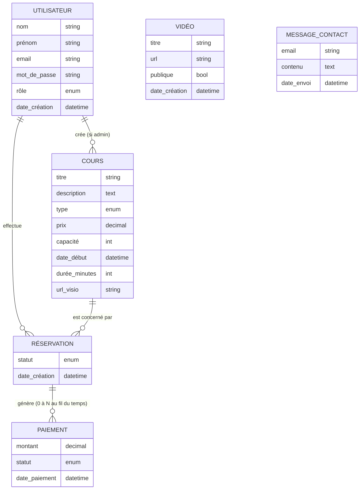

# Modèles Merise — Jasmine Teacher

Application de la méthode **Merise** au projet, en 3 niveaux : MCD → MLD → MPD.

> Note : la conception réelle a été faite directement en MPD (dans `database.sql`). Ce document **rétroconstruit** les niveaux supérieurs à partir du physique pour respecter la méthodologie.

> ⚠️ **Révision du 2026-11-05** (deux passes) : audit complet du document contre `database.sql` et le code des modules backend. Première passe : erreur de cardinalité corrigée (association RÉSERVATION—PAIEMENT), clé `UNIQUE` des réservations corrigée, politique de suppression `created_by` corrigée. Seconde passe (suite à une question directe) : `payments.booking_id` passé en nullable/`ON DELETE SET NULL` pour que la suppression d'un cours ou d'un utilisateur ne détruise plus jamais l'historique des paiements. Voir §7 "Historique des corrections" pour le détail complet.

---

## 1. MCD — Modèle Conceptuel de Données

Représentation des **entités** métier et de leurs **associations**, indépendamment de l'implémentation.



### Le rôle des cardinalités en Merise (rappel méthodologique)

Une cardinalité Merise se note `(min, max)` et s'attache **à une entité, pour une association donnée, vue du côté de l'autre entité**. Elle répond à deux questions distinctes :

- **`min`** (0 ou 1) : à quel point la participation est-elle **obligatoire** ? `0` = l'entité peut exister sans jamais participer à l'association (participation facultative) ; `1` = chaque occurrence de l'entité doit obligatoirement participer au moins une fois.
- **`max`** (1 ou N) : à quel point la participation est-elle **répétable** ? `1` = l'entité ne peut participer qu'**une seule fois** à l'association ; `N` = elle peut y participer un nombre illimité de fois.

Ces deux bornes ont chacune une **conséquence concrète sur l'implémentation physique** :

- Le `max` décide **où va la clé étrangère**. Dans une association binaire `(0,N)—(1,1)`, c'est toujours le côté `(1,1)` (le "max=1") qui porte la FK, car il ne peut être lié qu'à **une seule** occurrence de l'autre côté — c'est une colonne, pas une liste. Le côté `(0,N)` n'a pas besoin de FK, car il peut être lié à plusieurs occurrences : stocker la FK de son côté nécessiterait une table de liaison (utile seulement pour une association N-N, absente ici).
- Le `min` décide si la colonne FK est **`NOT NULL`** (`min=1`, participation obligatoire) ou **nullable** (`min=0`, participation facultative). Dans ce projet, `courses.created_by`, `bookings.user_id` et `bookings.course_id` sont `NOT NULL` (`min=1`) : chaque cours a forcément un créateur, chaque réservation porte forcément sur un élève et un cours. **Exception volontaire** (voir §7, correction du 2026-11-05) : `payments.booking_id` est, lui, **nullable** (`min=0` côté PAIEMENT, cf. ligne 4 du tableau ci-dessous) — un paiement reste la trace financière d'une transaction même après disparition de la réservation qui l'a déclenchée (suppression d'un cours ou d'un compte élève). C'est la seule FK nullable de ce schéma, choisie précisément pour ne jamais perdre un historique de paiement.

**Autrement dit** : lire une cardinalité ne sert pas qu'à dessiner un joli diagramme — chaque borne se traduit directement en une décision SQL vérifiable (`NOT NULL` ou pas, FK côté table A ou B, contrainte `UNIQUE` ou pas). Une cardinalité mal choisie ou mal transcrite peut donc rendre le schéma incohérent avec les règles de gestion qu'il est censé représenter — c'est exactement l'erreur qui a été trouvée et corrigée ici sur l'association RÉSERVATION—PAIEMENT (voir ligne 4 du tableau et §7).

### Cardinalités Merise

| Association | Côté A (lecture) | Côté B (lecture) | Détail complet |
|---|---|---|---|
| `UTILISATEUR — crée — COURS` | UTILISATEUR : (0,N) | COURS : (1,1) | **Côté UTILISATEUR = (0,N)** : un utilisateur peut avoir créé zéro cours (cas des `student`, et même d'un `admin` qui vient d'être créé) jusqu'à un nombre illimité de cours. **Côté COURS = (1,1)** : un cours a été créé par exactement un utilisateur, et cette information ne change jamais après coup (pas de "transfert de propriété" d'un cours dans l'app). → Le `(1,1)` est côté COURS, donc c'est `courses` qui porte la FK `created_by NOT NULL`. |
| `UTILISATEUR — effectue — RÉSERVATION` | UTILISATEUR : (0,N) | RÉSERVATION : (1,1) | **Côté UTILISATEUR = (0,N)** : un élève peut n'avoir jamais réservé (compte flambant neuf, ex. `diana@example.com` dans le seed), ou avoir réservé plusieurs fois. **Côté RÉSERVATION = (1,1)** : une réservation est toujours l'acte d'exactement un élève, et cet élève ne change jamais après création. → FK `bookings.user_id NOT NULL`. |
| `COURS — concerne — RÉSERVATION` | COURS : (0,N) | RÉSERVATION : (1,1) | **Côté COURS = (0,N)** : un cours peut n'avoir encore aucune réservation (vient d'être créé), jusqu'à `capacity` réservations actives (règle RG3, appliquée en applicatif, pas en SQL — voir `SCHEMAS.md` §1.4). **Côté RÉSERVATION = (1,1)** : une réservation porte toujours sur exactement un cours, qui ne change jamais. → FK `bookings.course_id NOT NULL`. |
| `RÉSERVATION — génère — PAIEMENT` | RÉSERVATION : (0,**N**) | PAIEMENT : (0,1) | **❌ Ancienne version de ce document (corrigée deux fois) : `(0,1)` côté RÉSERVATION, puis `(1,1)` côté PAIEMENT.** Erreur n°1 (corrigée le 2026-11-05) : le code (`paymentsActions.refund` + `bookingsActions.editStatus`, qui permet à un admin de repasser une réservation remboursée en `pending` pour qu'elle soit repayée) autorise explicitement **plusieurs** paiements successifs pour la **même** réservation au fil de sa vie (un paiement initial, un remboursement, un second paiement) → **côté RÉSERVATION = (0,N)**. Erreur n°2 (corrigée le même jour, voir §7) : on supposait qu'un paiement reste *toujours* rattaché à sa réservation d'origine (`(1,1)`), mais `DELETE /api/courses/:id` et `DELETE /api/users/:id` peuvent faire disparaître cette réservation (cascade volontaire) — dans ce cas le paiement doit **survivre** comme trace financière plutôt que d'être détruit avec elle. **Côté PAIEMENT = (0,1)** : un paiement est rattaché à **au plus une** réservation, et peut n'en avoir **aucune** (`booking_id NULL`) si celle-ci a été supprimée depuis. → FK `payments.booking_id` **nullable**, `ON DELETE SET NULL` (et non `CASCADE`), toujours **sans** contrainte `UNIQUE` (une `UNIQUE(booking_id)` casserait le flux de re-paiement réel — voir `SCHEMAS.md` §1.5/§1.6 et §7 ci-dessous). |

### Règles de gestion (RG)

| RG | Énoncé |
|---|---|
| RG1 | Un utilisateur s'inscrit en tant que `student` par défaut. Seul l'admin peut promouvoir un utilisateur au rôle `admin`. |
| RG2 | Une réservation n'est possible qu'au minimum **7 jours** avant la date du cours. |
| RG3 | Le nombre de réservations actives d'un cours ne peut dépasser sa `capacité`. |
| RG4 | Un même utilisateur ne peut pas avoir deux réservations **actives** (`pending` ou `confirmed`) sur le même cours — une réservation **annulée** ne compte pas et n'empêche pas une réinscription ultérieure sur le même cours. |
| RG5 | Le prix payé est toujours recalculé côté serveur depuis le cours (jamais transmis par le client). |
| RG6 | Une réservation passe en `confirmed` normalement uniquement après un paiement réussi (Stripe ou mock) ; un admin dispose toutefois d'un contournement manuel volontaire via `PUT /bookings/:id` (cf. `SCHEMAS.md` §10) pour les cas de paiement hors ligne. |
| RG7 | Une vidéo `is_public=false` n'est accessible qu'aux utilisateurs connectés. |
| RG8 | *(nouvelle, rendue explicite par la correction du §7)* Une réservation peut déclencher **plusieurs** paiements successifs dans le temps (paiement → remboursement → nouveau paiement), mais jamais deux paiements `status='paid'` simultanément actifs sans remboursement entre les deux — cette dernière contrainte n'est **pas** enforcée en SQL (ce serait un trigger), elle dépend de la discipline du flux admin (`refund` avant de réouvrir en `pending`). |
| RG9 | *(nouvelle)* Un utilisateur ne peut pas être supprimé (`DELETE /api/users/:id`) tant qu'il reste des cours dont il est le créateur (`courses.created_by`) — il faut d'abord réassigner ou supprimer ces cours. Protège l'historique des réservations et paiements liés contre une suppression en cascade involontaire. |

---

## 2. MLD — Modèle Logique de Données

Transformation du MCD en **schéma relationnel**. Chaque entité devient une table ; chaque association `(0,N) — (1,1)` migre la clé via une FK.

```text
USERS (
  id              [PK]
  lastname        VARCHAR
  firstname       VARCHAR
  email           VARCHAR  [UNIQUE]
  password_hash   VARCHAR
  role            ENUM('student', 'admin')
  created_at      DATETIME
)

COURSES (
  id              [PK]
  title           VARCHAR
  description     TEXT
  type            ENUM('collectif', 'individuel', 'enfant_collectif', 'enfant_individuel')
  price           DECIMAL
  capacity        INT
  start_at        DATETIME
  duration_minutes INT
  visio_url       VARCHAR
  created_by      [FK → USERS.id]
)

BOOKINGS (
  id                [PK]
  user_id           [FK → USERS.id]
  course_id         [FK → COURSES.id]
  status            ENUM('pending', 'confirmed', 'cancelled')
  created_at        DATETIME
  active_course_id  INT (colonne virtuelle : course_id si status != 'cancelled', sinon NULL)
  [UNIQUE (user_id, active_course_id)]   -- cf. §2.1 : porte sur les réservations ACTIVES seulement
)

PAYMENTS (
  id              [PK]
  booking_id      [FK → BOOKINGS.id, NULLABLE, ON DELETE SET NULL]
  amount          DECIMAL
  status          ENUM('pending', 'paid', 'refunded')
  paid_at         DATETIME
  -- PAS de UNIQUE(booking_id) : association (0,N) et non (0,1), cf. §1
  -- booking_id nullable : un paiement survit a la suppression de sa reservation
  -- (cascade cours/user), cf. §7
)

VIDEOS (
  id              [PK]
  title           VARCHAR
  url             VARCHAR
  is_public       BOOLEAN
  created_at      DATETIME
)

CONTACT_MESSAGES (
  id              [PK]
  email           VARCHAR  [NULLABLE]
  message         TEXT
  created_at      DATETIME
)
```

### Conventions de transformation

- Toute entité Merise → table relationnelle.
- Association `(0,N) — (1,1)` → la table du côté `(1,1)` reçoit la FK (`created_by`, `user_id`, `course_id`). Exception : `booking_id` sur `PAYMENTS` (voir ci-dessous).
- Pour une association où le côté `(1,1)` est en réalité `(0,1)` **au sens strict** (ex. "une réservation a au plus un paiement À UN INSTANT DONNÉ, mais peut en avoir eu plusieurs dans le temps"), il faut choisir : soit (a) matérialiser la relation comme un **historique** `(0,N)` — c'est le choix fait ici pour `RÉSERVATION — PAIEMENT`, la table `PAYMENTS` peut recevoir plusieurs lignes pour le même `booking_id` — soit (b) la contraindre à un vrai `(0,1)` avec `UNIQUE(booking_id)` si on veut interdire tout second paiement. **Le choix (a) a été retenu** car il correspond au comportement réel voulu par le code (flux remboursement → re-paiement). Voir §1 et §7 pour l'historique de cette correction.
- **`payments.booking_id` est l'exception nullable du schéma** (§7) : la règle "FK du côté (1,1) ⇒ NOT NULL" ne s'applique plus ici parce que le côté PAIEMENT est en réalité `(0,1)`, pas `(1,1)` — un paiement doit pouvoir survivre à la suppression de sa réservation. D'où `booking_id INT NULL` + `ON DELETE SET NULL` au lieu de `CASCADE` : la ligne `payments` (montant, statut, date) reste consultable, seule la référence à la booking disparue est effacée.
- Pour l'association `UTILISATEUR — effectue — RÉSERVATION` combinée à la règle RG4 ("pas 2 réservations actives sur le même cours"), une contrainte `UNIQUE` simple sur `(user_id, course_id)` aurait semblé suffire, mais elle aurait figé la cardinalité `(1,1)` côté RÉSERVATION même pour les lignes `cancelled`, ce qui est trop strict par rapport à la RG4 (qui ne parle que des réservations **actives**). La solution retenue est une colonne générée `active_course_id` (NULL quand annulée) combinée à un `UNIQUE(user_id, active_course_id)` : MySQL autorisant plusieurs `NULL` dans un index unique, l'unicité ne s'applique qu'aux lignes actives. Voir §2.1 et §7.
- Pas d'association N-N dans ce modèle → pas besoin de table de liaison.

---

## 3. MPD — Modèle Physique de Données

Implémentation **réelle** en MySQL 8 / TiDB 8.5 (compatible MySQL). Fichier source : `database.sql`.

```sql
CREATE TABLE IF NOT EXISTS users (
  id INT PRIMARY KEY AUTO_INCREMENT,
  lastname VARCHAR(100) NOT NULL,
  firstname VARCHAR(100) NOT NULL,
  email VARCHAR(255) NOT NULL UNIQUE,
  password_hash VARCHAR(255) NOT NULL,
  role ENUM('student', 'admin') NOT NULL DEFAULT 'student',
  created_at DATETIME DEFAULT CURRENT_TIMESTAMP
);

CREATE TABLE IF NOT EXISTS courses (
  id INT PRIMARY KEY AUTO_INCREMENT,
  title VARCHAR(200) NOT NULL,
  description TEXT,
  type ENUM('collectif', 'individuel', 'enfant_collectif', 'enfant_individuel') NOT NULL,
  price DECIMAL(6, 2) NOT NULL CHECK (price >= 0),
  capacity INT NOT NULL DEFAULT 10 CHECK (capacity >= 1),
  start_at DATETIME NOT NULL,
  duration_minutes INT NOT NULL DEFAULT 60 CHECK (duration_minutes >= 15),
  visio_url VARCHAR(500),
  created_by INT NOT NULL,
  FOREIGN KEY (created_by) REFERENCES users(id) ON DELETE RESTRICT
);

CREATE TABLE IF NOT EXISTS bookings (
  id INT PRIMARY KEY AUTO_INCREMENT,
  user_id INT NOT NULL,
  course_id INT NOT NULL,
  status ENUM('pending', 'confirmed', 'cancelled') NOT NULL DEFAULT 'pending',
  created_at DATETIME DEFAULT CURRENT_TIMESTAMP,
  active_course_id INT GENERATED ALWAYS AS (IF(status = 'cancelled', NULL, course_id)) VIRTUAL,
  UNIQUE KEY uniq_user_active_course (user_id, active_course_id),
  FOREIGN KEY (user_id) REFERENCES users(id) ON DELETE CASCADE,
  FOREIGN KEY (course_id) REFERENCES courses(id) ON DELETE CASCADE
);

CREATE TABLE IF NOT EXISTS payments (
  id INT PRIMARY KEY AUTO_INCREMENT,
  booking_id INT NULL,
  amount DECIMAL(6, 2) NOT NULL CHECK (amount >= 0),
  status ENUM('pending', 'paid', 'refunded') NOT NULL DEFAULT 'pending',
  paid_at DATETIME,
  FOREIGN KEY (booking_id) REFERENCES bookings(id) ON DELETE SET NULL
);

CREATE TABLE IF NOT EXISTS videos (
  id INT PRIMARY KEY AUTO_INCREMENT,
  title VARCHAR(200) NOT NULL,
  url VARCHAR(500) NOT NULL,
  is_public BOOLEAN NOT NULL DEFAULT TRUE,
  created_at DATETIME DEFAULT CURRENT_TIMESTAMP
);

CREATE TABLE IF NOT EXISTS contact_messages (
  id INT PRIMARY KEY AUTO_INCREMENT,
  email VARCHAR(255),
  message TEXT NOT NULL,
  created_at DATETIME DEFAULT CURRENT_TIMESTAMP
);
```

### Choix techniques notables au MPD

| Choix | Justification |
|---|---|
| `INT AUTO_INCREMENT` pour les PK | Compromis perf/simplicité, suffisant à l'échelle du projet |
| `VARCHAR(255)` pour les emails | Limite RFC 5321 |
| `ENUM` pour `role`, `type`, `status` | Plus économique en stockage qu'un VARCHAR libre, et auto-validé par MySQL |
| `DECIMAL(6,2)` pour les prix et montants | Évite les imprécisions du flottant (40.00, jamais 40.0000001) |
| `CHECK (price >= 0)`, `CHECK (capacity >= 1)`, `CHECK (duration_minutes >= 15)`, `CHECK (amount >= 0)` | *(ajoutés le 2026-11-05)* Défense en profondeur : ces bornes sont déjà vérifiées côté TypeScript (`coursesActions.parseCourseInput`), mais les porter aussi en SQL protège contre un bug applicatif futur, un script de migration mal écrit, ou un accès direct à la base. |
| `ON DELETE CASCADE` sur `bookings.user_id`, `bookings.course_id` | Comportement **voulu** : supprimer un cours ou un compte élève retire logiquement les réservations qui le concernent (comme l'annulation d'un abonnement quand le produit ou le compte disparaît) — pas d'orphelin `bookings` à gérer manuellement. |
| `ON DELETE SET NULL` sur `payments.booking_id` *(corrigé le 2026-11-05, était `CASCADE` + `NOT NULL`, voir §7)* | Un paiement est une trace financière qui ne doit **jamais** disparaître comme simple effet de bord de la suppression d'un cours ou d'un compte. Quand la `booking` liée est supprimée par cascade, la ligne `payments` (montant, statut, date) est conservée avec `booking_id = NULL` au lieu d'être détruite. |
| `ON DELETE RESTRICT` sur `courses.created_by` *(corrigé le 2026-11-05, était `CASCADE`)* | Un cours a une cardinalité `(1,1)` côté créateur, mais le laisser en `CASCADE` permettait à la suppression d'un seul compte admin de faire disparaître en chaîne tous ses cours, puis toutes les réservations et paiements de tous les élèves sur ces cours — destruction d'historique financier inacceptable. `RESTRICT` bloque la suppression d'un `user` tant qu'il reste des `courses` à son nom ; il faut les réassigner/supprimer explicitement d'abord. |
| `UNIQUE(user_id, active_course_id)` sur `bookings` *(corrigé le 2026-11-05, était `UNIQUE(user_id, course_id)`)* | Implémente la RG4 **exactement comme énoncée** ("réservations actives") grâce à la colonne générée `active_course_id` (NULL si `cancelled`). L'ancienne version portait sur toutes les lignes sans distinction de statut, ce qui bloquait à tort toute réinscription après une annulation (voir `SCHEMAS.md` §1.5 pour la reproduction du bug). |
| Pas de `UNIQUE(booking_id)` sur `payments` | Volontaire : l'association RÉSERVATION—PAIEMENT est `(0,N)`, pas `(0,1)` — voir §1 et §7. Une telle contrainte casserait le flux remboursement → re-paiement. |
| Pas de tables d'index secondaire | Volumes prévus < 10k lignes, le scan est acceptable |

---

## 4. Couverture du CRUD par les modules

Chaque table du MPD a un module backend complet selon le pattern Action / Repository / Routes :

| Table | C | R | U | D | Module backend |
|---|---|---|---|---|---|
| `users` | POST /auth/register | GET /users | PUT /users/:id | DELETE /users/:id | `auth/` + `users/` |
| `courses` | POST /courses | GET /courses, GET /courses/:id | PUT /courses/:id | DELETE /courses/:id | `courses/` |
| `bookings` | POST /bookings | GET /bookings/me, GET /bookings/all | PUT /bookings/:id | DELETE /bookings/:id | `bookings/` |
| `payments` | POST /payments + Stripe | GET /payments | PUT /payments/:id/refund | — (trace immuable) | `payments/` |
| `videos` | POST /videos | GET /videos, GET /videos/all | PUT /videos/:id | DELETE /videos/:id | `videos/` |
| `contact_messages` | POST /contact | GET /contact | — (pas de modification) | DELETE /contact/:id | `contact/` |

---

## 5. Cohérence Merise ↔ User Stories

| US (cf `infos/User Stories.pdf`) | Niveau touché | Opération MPD |
|---|---|---|
| US3 Visiteur crée un compte | UTILISATEUR | `INSERT INTO users` |
| US5 Élève se connecte | UTILISATEUR | `SELECT FROM users WHERE email` + bcrypt verify |
| US6 Élève réserve un cours | RÉSERVATION (+ vérif COURS) | `INSERT INTO bookings` après contrôle RG2/RG3/RG4 |
| US7 Élève paie un cours | PAIEMENT (+ MAJ RÉSERVATION) | `INSERT INTO payments` + `UPDATE bookings SET status='confirmed'` |
| US10 Élève annule | RÉSERVATION | `UPDATE bookings SET status='cancelled'` |
| US11 Admin crée un cours | COURS | `INSERT INTO courses` |
| US12 Admin modifie/supprime | COURS | `UPDATE courses` / `DELETE FROM courses` |
| US13 Admin liste les élèves | UTILISATEUR | `SELECT FROM users` (sans password_hash) |
| US14 Admin gère paiements | PAIEMENT | `SELECT FROM payments` + refund |
| US15 Admin ajoute une vidéo | VIDÉO | `INSERT INTO videos` |

---

## 6. Vérification

```bash
# Importer le MPD dans une base MySQL fraîche
mysql -u root -p < database.sql

# Vérifier qu'on a les 6 tables attendues
mysql -u root -D jasmine_teacher -e "SHOW TABLES;"
# bookings, contact_messages, courses, payments, users, videos

# Vérifier que les contraintes corrigées sont bien en place
mysql -u root -D jasmine_teacher -e "SHOW CREATE TABLE bookings;"
# → doit montrer la colonne virtuelle active_course_id et
#   UNIQUE KEY uniq_user_active_course (user_id, active_course_id)

mysql -u root -D jasmine_teacher -e "SHOW CREATE TABLE courses;"
# → doit montrer CONSTRAINT ... FOREIGN KEY (created_by) REFERENCES users (id)
#   avec ON DELETE RESTRICT (pas CASCADE)
```

**Test manuel de non-régression de la correction RG4** (réinscription après annulation) :

```sql
-- Avant la correction, la 2e insertion ci-dessous échouait avec ER_DUP_ENTRY.
INSERT INTO bookings (user_id, course_id, status) VALUES (1, 1, 'cancelled');
INSERT INTO bookings (user_id, course_id, status) VALUES (1, 1, 'pending');  -- doit réussir
-- Par contre, 2 réservations ACTIVES sur le même cours doivent toujours échouer :
INSERT INTO bookings (user_id, course_id, status) VALUES (1, 1, 'pending');  -- doit échouer (ER_DUP_ENTRY)
```

Cohérent avec le MLD.

---

## 7. Historique des corrections (audit du 2026-11-05)

Ce document (et `SCHEMAS.md`) a été relu intégralement et comparé à `database.sql` ainsi qu'au code réel des modules `bookings`, `payments` et `courses`. Trois erreurs ont été trouvées et corrigées, plus trois ajouts de robustesse :

| # | Problème trouvé | Où | Correction appliquée | Pourquoi c'est important |
|---|---|---|---|---|
| 1 | Cardinalité `RÉSERVATION (0,1) — PAIEMENT (1,1)` documentée dans le MCD et dans `SCHEMAS.md`, alors que le code (remboursement puis re-paiement via `PUT /bookings/:id` + `POST /payments`) crée volontairement plusieurs paiements pour une même réservation. | `MERISE.md` §1, `SCHEMAS.md` §1 | Cardinalité corrigée en `(0,N)`. Aucun changement SQL nécessaire : l'absence de `UNIQUE(booking_id)` dans `database.sql` était en fait **déjà correcte**, c'est la documentation qui avait tort. | Une documentation de cardinalité fausse peut pousser un futur développeur à "corriger" le SQL dans le mauvais sens (ajouter un `UNIQUE` qui casserait un flux métier réel). |
| 2 | `UNIQUE KEY uniq_user_course (user_id, course_id)` dans `bookings` portait sur toutes les lignes, y compris `cancelled`, alors que la RG4 et le code applicatif (`findActiveByUserAndCourse`) ne visent que les réservations **actives**. | `database.sql`, répercuté dans `MERISE.md` §2/§3 et `SCHEMAS.md` §1 | Remplacement par une colonne générée virtuelle `active_course_id` + `UNIQUE KEY uniq_user_active_course (user_id, active_course_id)`. | Bug réellement reproductible : un élève qui annule puis tente de se réinscrire au même cours recevait une erreur 500 (`ER_DUP_ENTRY` non interceptée) au lieu de pouvoir se réinscrire. |
| 3 | `courses.created_by` en `ON DELETE CASCADE` : supprimer un admin supprimait en cascade tous ses cours, puis toutes les réservations et paiements de tous les élèves concernés. | `database.sql`, répercuté dans `MERISE.md` §3 et `SCHEMAS.md` §1 | Remplacement par `ON DELETE RESTRICT`. | Risque d'intégrité et d'audit : un historique financier (`payments`) ne doit jamais pouvoir disparaître à cause de la suppression d'un compte tiers (l'admin), via une route (`DELETE /api/users/:id`) qui n'a aucune idée de cet effet de bord. |
| 4 | *(robustesse, pas un bug)* Pas de `CHECK` SQL sur `price`, `capacity`, `duration_minutes`, `amount` — ces bornes n'étaient vérifiées que côté TypeScript. | `database.sql` | Ajout de 4 contraintes `CHECK`. | Défense en profondeur : protège même en cas de bug applicatif ou d'accès direct à la base. |
| 5 | *(documentation)* `SCHEMAS.md` §4 documentait le contrôle anti-doublon comme géré par un `ER_DUP_ENTRY` sur `INSERT`, alors que le code le fait via un `SELECT` explicite **avant** l'insertion. | `SCHEMAS.md` §4 | Diagramme de séquence corrigé pour refléter l'ordre réel des vérifications (date → doublon actif → capacité → insertion). | Un diagramme de séquence qui ne correspond pas au code induit en erreur quiconque l'utilise pour comprendre ou modifier le flux de réservation. |
| 6 | *(documentation)* `SCHEMAS.md` §5 affirmait encore "webhook Stripe à implémenter", alors que `paymentsActions.webhook` est pleinement implémenté (signature vérifiée, idempotence, `metadata.bookingId`). | `SCHEMAS.md` §5 | Note remplacée par un diagramme de séquence dédié au webhook, avec les garanties de robustesse déjà en place. | Une note "à faire" obsolète fait perdre du temps à qui la lit en pensant qu'une fonctionnalité critique de sécurité des paiements manque encore. |
| 7 | *(bug confirmé, trouvé suite à une question directe le 2026-11-05)* `DELETE /api/courses/:id` et `DELETE /api/users/:id` n'ont aucune vérification ; `payments.booking_id` était en `ON DELETE CASCADE` → supprimer un cours ou un compte élève effaçait silencieusement, en cascade, **les paiements déjà encaissés** liés à ses réservations, sans confirmation ni trace. | `database.sql`, `paymentsRepository.ts`, `paymentsActions.ts`, répercuté dans `MERISE.md` §1/§2/§3 et `SCHEMAS.md` §1 | `payments.booking_id` passe de `NOT NULL`/`CASCADE` à **nullable**/`ON DELETE SET NULL` : la cascade sur `bookings` (courses/users) reste **voulue**, mais le paiement survit désormais avec `booking_id = NULL` au lieu d'être détruit. `paymentsActions.refund` mis à jour pour gérer ce cas. Vérifié empiriquement (Docker). | Une suppression de cours ou de compte élève est une opération admin courante et non bloquante par choix produit — elle ne doit jamais, comme simple effet de bord, effacer un historique financier/comptable. |

**Ce qui n'a volontairement PAS été changé**, pour rester dans le périmètre strict des schémas/cardinalités et ne pas introduire de régression non demandée :

- `bookings.user_id` et `bookings.course_id` restent en `ON DELETE CASCADE` : supprimer un cours ou un compte élève retire logiquement les réservations qui le concernent — comportement **explicitement validé** comme voulu ("comme n'importe quel site : si quelqu'un supprime son compte, son abonnement/sa réservation est aussi annulé"), et non une erreur à bloquer. Seul `payments.booking_id` a été changé (voir ligne 7 ci-dessus), car lui seul représente un historique financier qui ne doit jamais disparaître.
- `bookingsActions.editStatus` (route admin `PUT /bookings/:id`) continue d'autoriser toute transition de statut sans validation stricte des transitions — comportement **documenté comme volontaire** par le commentaire du code lui-même (permet de corriger manuellement après un paiement hors ligne). Signalé comme point de vigilance dans `SCHEMAS.md` §10, non modifié.
