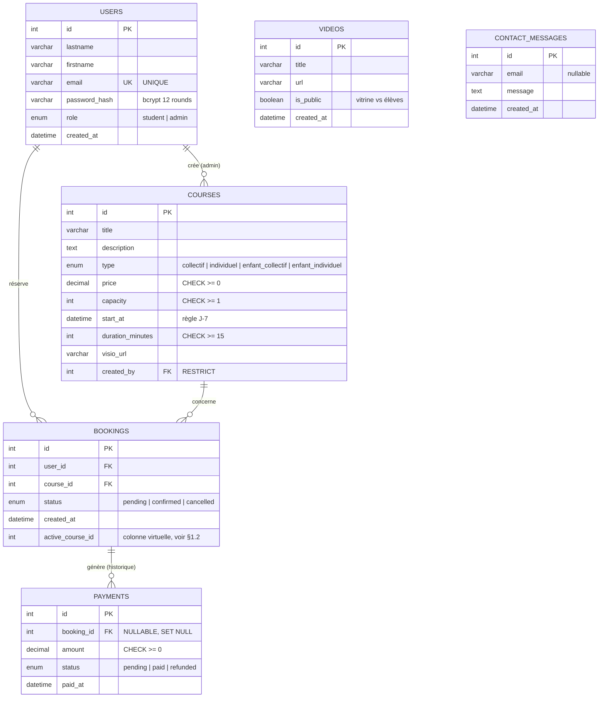
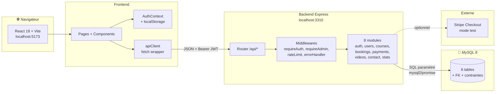
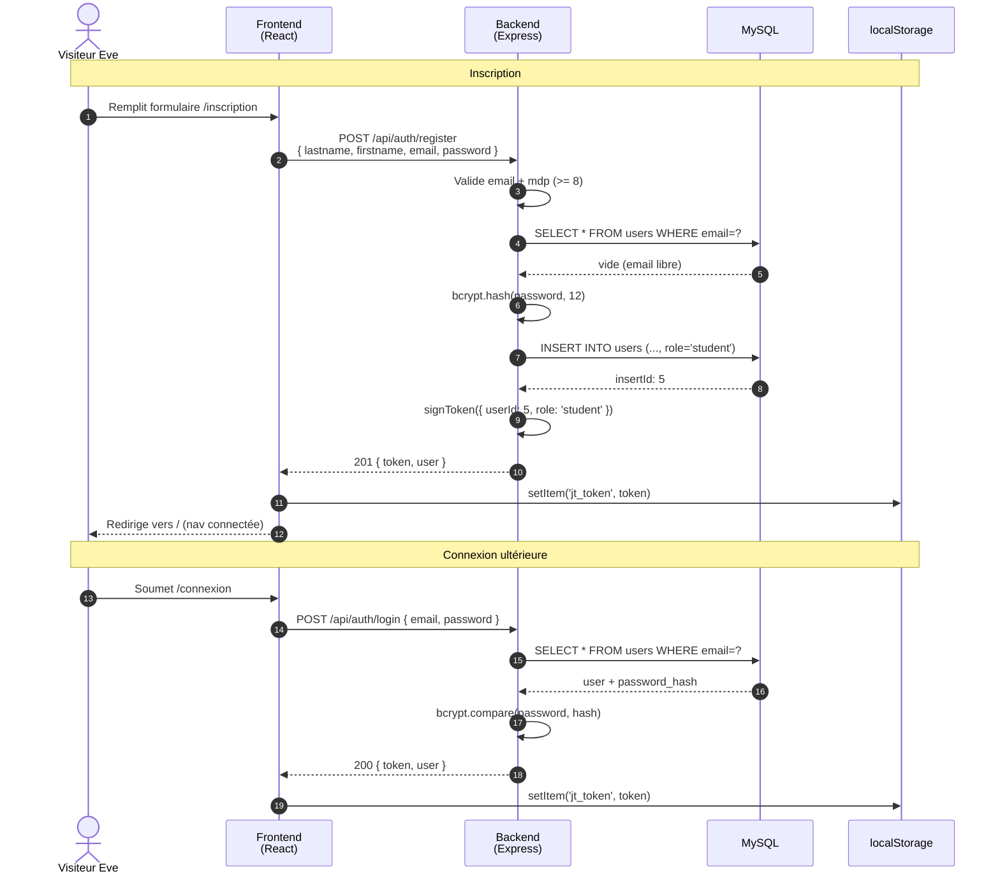
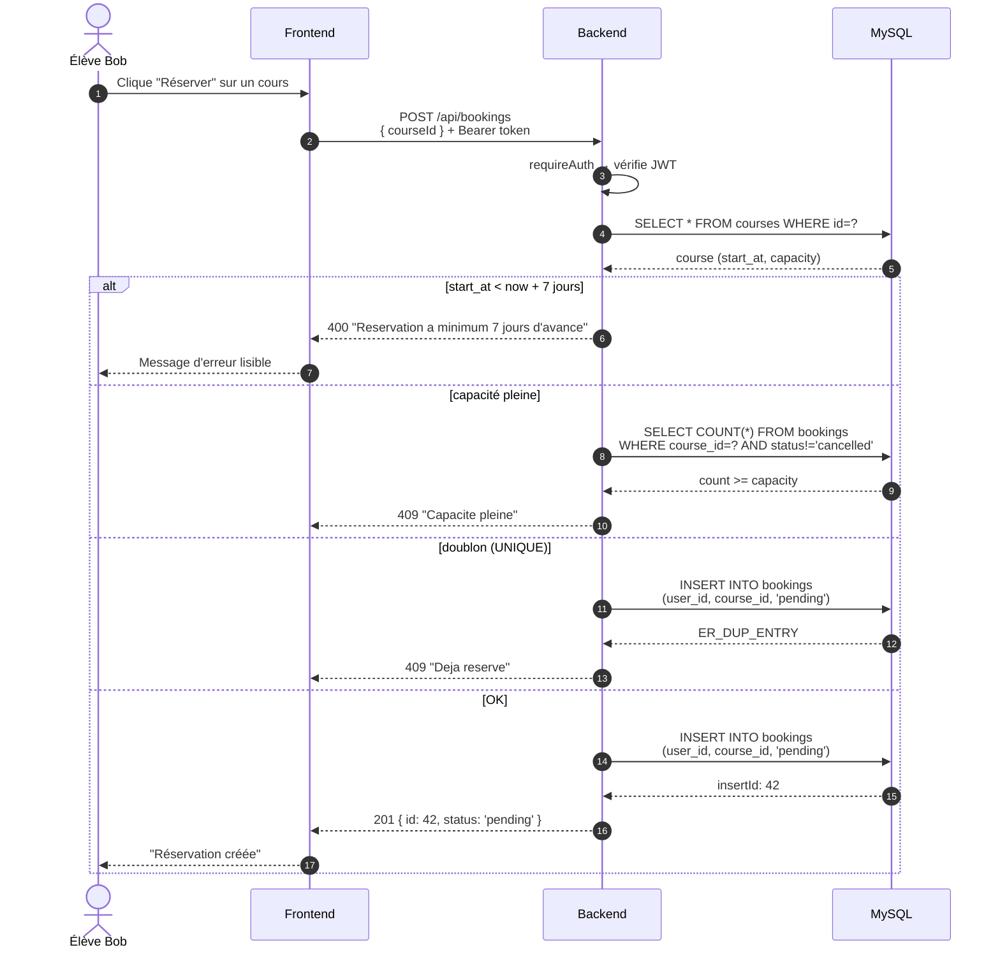
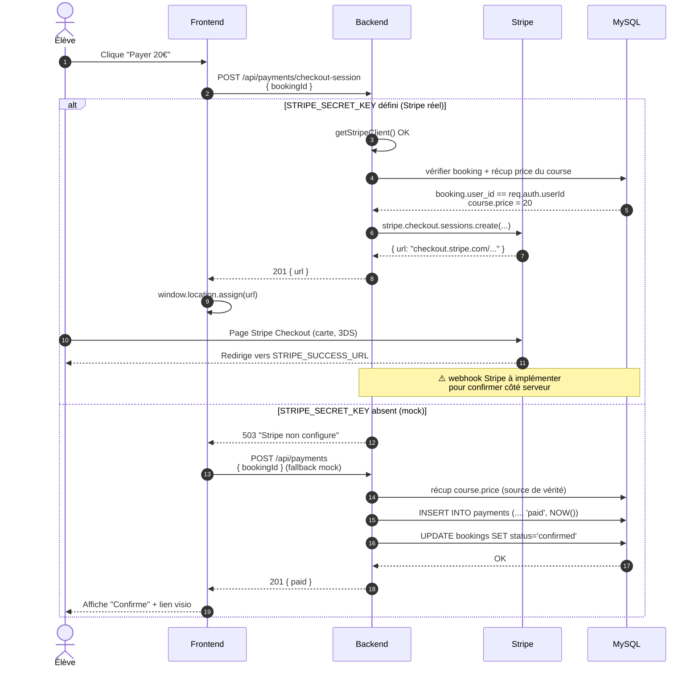
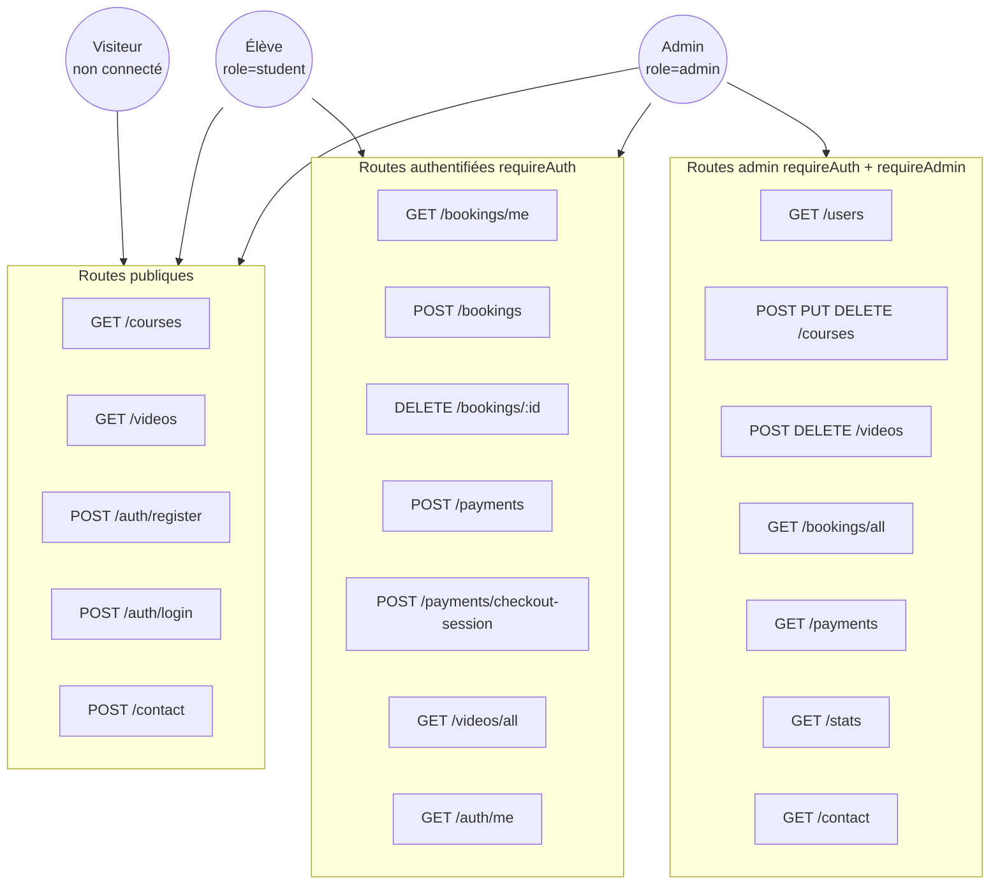
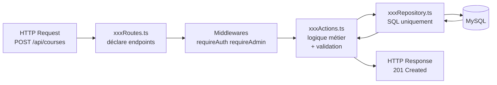
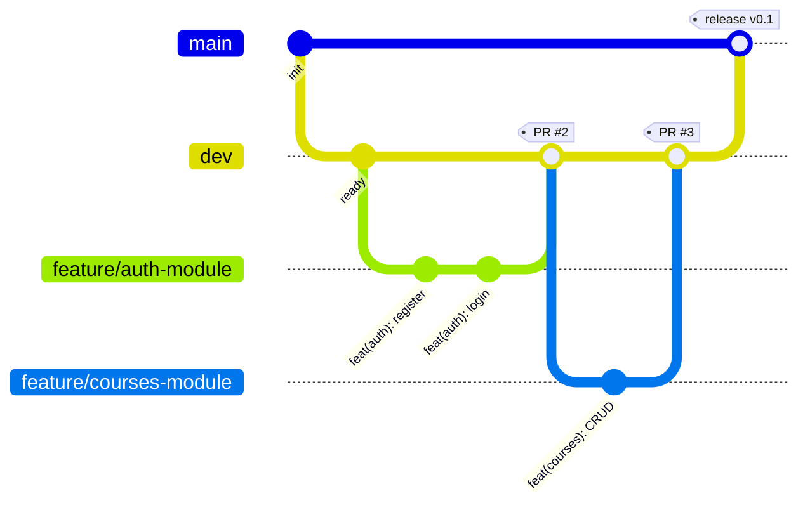
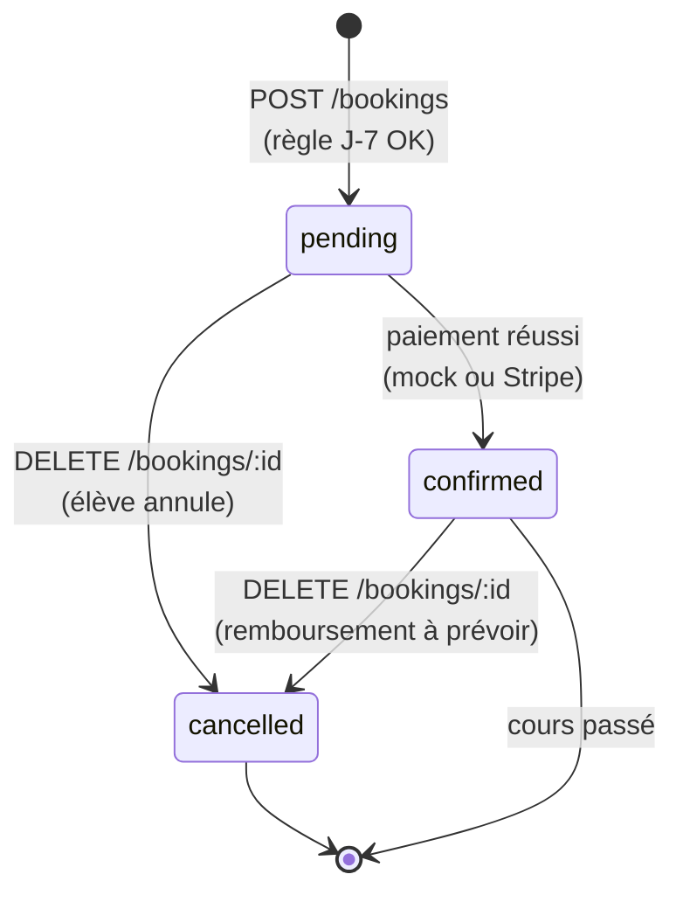
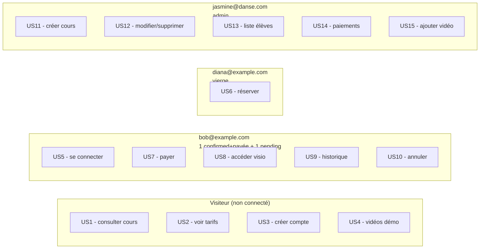

# Schémas — Jasmine Teacher

Tous les schémas du projet en **Mermaid** (rendu natif par GitHub). Ouvre ce fichier directement sur GitHub pour voir les diagrammes ; en local, n'importe quel rendu Markdown qui supporte Mermaid (VS Code + extension, Typora, Obsidian…) les affichera.

> ⚠️ **Note de révision (2026-11-05, deux passes)** : ce document a été audité intégralement et corrigé. Les diagrammes ci-dessous reflètent maintenant exactement `database.sql`. Détail des trois premières corrections en §1.5 ; détail de la correction suivante (suppression cours/utilisateur ne doit jamais détruire un paiement) en §1.6.

---

## 1. Modèle de données (Entity Relationship)

Les 6 tables MySQL avec leurs relations et contraintes.



### 1.1. Comment lire la notation Mermaid des cardinalités (crow's foot)

Chaque relation du diagramme ci-dessus est écrite `ENTITE_A <symbole_gauche>--<symbole_droit> ENTITE_B`. Les symboles encodent la cardinalité **de chaque côté**, exactement comme en Merise (notation `(min,max)`) mais en version graphique ("patte de corbeau") :

| Symbole Mermaid | Équivalent Merise | Signification |
|---|---|---|
| `\|\|` (trait double) | `(1,1)` | **Un et un seul** — l'entité en face est obligatoire et unique. |
| `o\|` | `(0,1)` | **Zéro ou un** — l'entité en face est optionnelle, au plus une fois. |
| `o{` | `(0,N)` | **Zéro ou plusieurs** — l'entité en face est optionnelle, sans limite. |
| `\|{` | `(1,N)` | **Un ou plusieurs** — l'entité en face est obligatoire, au moins une fois. |

Le symbole est toujours lu **du point de vue de l'entité opposée** (c'est le piège classique). Par exemple dans `USERS ||--o{ COURSES`, on lit : « à un COURSES donné correspond exactement un USERS (`\|\|`, côté gauche) ; à un USERS donné correspondent zéro ou plusieurs COURSES (`o{`, côté droit) ». C'est l'inverse de ce qu'on pourrait croire en lisant juste "USERS ... COURSES" de gauche à droite.

**Pourquoi c'est important de documenter ça** : une cardinalité mal lue (ou mal transcrite dans le diagramme) ne casse rien à la compilation — elle fausse juste la compréhension du modèle, et peut faire écrire une règle métier ou une contrainte SQL incohérente avec le reste du code. C'est précisément ce qui s'est produit ici (cf. §1.5) : le diagramme affichait `BOOKINGS ||--o| PAYMENTS`, documentant au plus **un** paiement par réservation, alors que le code applicatif (`paymentsActions.refund` + `bookingsActions.editStatus`) autorise explicitement un second paiement après un remboursement. Le diagramme mentait sur une règle métier réelle.

### 1.2. Détail des 4 relations du schéma

| # | Relation (lecture Mermaid) | Lecture Merise équivalente | Explication métier |
|---|---|---|---|
| 1 | `USERS \|\|--o{ COURSES` | USERS (0,N) — COURSES (1,1) | Un `user` (forcément `role='admin'` en pratique, mais rien ne l'impose au niveau SQL — c'est une règle applicative, RG1) peut créer **0 à N** cours. Un `course` a **exactement un** créateur, matérialisé par la colonne `created_by` (NOT NULL). C'est pour ça que la clé étrangère vit dans `courses` : c'est toujours le côté `(1,1)` d'une association `(0,N)-(1,1)` qui porte la FK. |
| 2 | `USERS \|\|--o{ BOOKINGS` | USERS (0,N) — BOOKINGS (1,1) | Un élève (`user`) peut effectuer **0 à N** réservations au fil du temps. Une réservation appartient **toujours à exactement un** élève (`user_id NOT NULL`). |
| 3 | `COURSES \|\|--o{ BOOKINGS` | COURSES (0,N) — BOOKINGS (1,1) | Un cours peut recevoir **0 à N** réservations (jusqu'à sa `capacity`, contrôlée en applicatif, pas en SQL — voir §1.4). Une réservation porte **toujours sur exactement un** cours (`course_id NOT NULL`). |
| 4 | `BOOKINGS \|\|--o{ PAYMENTS` | BOOKINGS (0,N) — PAYMENTS (0,1) | **Corrigé deux fois** (voir §1.5 et §1.6) : une réservation peut n'avoir **aucun** paiement (tant qu'elle est `pending`), **un seul** (cas normal : payée une fois, `status='confirmed'`), ou **plusieurs au fil du temps** si elle a été remboursée puis repayée (un admin peut repasser une booking en `pending` via `PUT /bookings/:id` après un remboursement, et l'élève peut alors la payer à nouveau — `paymentsActions.pay` n'interdit que les bookings déjà `confirmed`). Côté PAYMENTS, la cardinalité est désormais **(0,1)** et non plus `(1,1)` : un paiement référence **au plus une** réservation, et peut n'en référencer **aucune** (`booking_id NULL`) si la booking d'origine a été supprimée via la cascade `courses`/`users` (voir §1.6) — le paiement survit toujours comme trace financière. |

### 1.3. Pourquoi `videos` et `contact_messages` n'ont pas de flèche sur le diagramme

Ce ne sont **pas des erreurs d'oubli** : ces deux tables n'ont volontairement **aucune clé étrangère**, donc **aucune association** au sens Merise avec le reste du modèle.

- `videos` : une vidéo est une ressource globale (vitrine ou réservée), pas liée à un cours ni à un élève précis — on ne trace pas qui l'a uploadée (c'est toujours Jasmine, l'unique admin).
- `contact_messages` : un message de contact peut être envoyé par un **visiteur non connecté**, donc il n'existe pas forcément de ligne `users` correspondante à référencer. L'`email` est un simple champ texte déclaratif, pas une FK.

### 1.4. Contraintes SQL vs règles métier : ce qui est appliqué où

Toutes les règles de gestion (RG, voir `MERISE.md` §1) ne sont pas forcément enforcées par une contrainte SQL. Tableau de répartition :

| Règle | Appliquée en SQL (DDL) ? | Appliquée en applicatif (TypeScript) ? |
|---|---|---|
| RG2 — réservation à J-7 minimum | ❌ (une `DATETIME` ne sait pas comparer à "aujourd'hui + 7 jours" de façon déclarative simple) | ✅ `bookingsActions.add` |
| RG3 — capacité du cours | ❌ (nécessiterait un trigger `BEFORE INSERT` comptant les lignes actives, non utilisé ici par choix de simplicité) | ✅ `bookingsActions.add` (`countActiveByCourse`) |
| RG4 — pas 2 réservations actives sur le même cours | ✅ `UNIQUE KEY uniq_user_active_course` (corrigé, voir §1.5) | ✅ `bookingsRepository.findActiveByUserAndCourse` (double défense) |
| Prix/capacité/durée toujours positifs | ✅ `CHECK (price >= 0)`, `CHECK (capacity >= 1)`, `CHECK (duration_minutes >= 15)` (ajoutés, voir §1.5) | ✅ `coursesActions.parseCourseInput` (double défense) |
| Email unique | ✅ `UNIQUE` sur `users.email` | ✅ vérifié avant insertion dans `authActions.register` |

**Pourquoi dupliquer la validation (SQL + TypeScript) alors que ça fait deux fois le même travail ?** Parce que ce sont deux lignes de défense à deux niveaux différents : la validation applicative donne un message d'erreur clair et immédiat (ex. `400 "Cours complet"`), tandis que la contrainte SQL est le **dernier rempart** qui protège l'intégrité des données même si un bug applicatif, un script de migration, ou un accès direct à la base contournait la couche TypeScript. C'est le principe de "defense in depth" déjà appliqué par le projet (cf. `CLAUDE.md` §8, checklist sécurité).

### 1.5. Historique des corrections (audit du 2026-11-05)

Trois défauts ont été identifiés en comparant `database.sql` (le schéma réellement appliqué), le code des modules `bookings`/`payments`/`courses`, et les diagrammes ci-dessus — puis corrigés dans `database.sql` :

1. **`BOOKINGS ||--o| PAYMENTS` → `BOOKINGS ||--o{ PAYMENTS`** (cardinalité erronée, pas un problème SQL). Le diagramme affirmait au plus un paiement par réservation, ce qui est faux : le flux remboursement → réouverture → re-paiement crée volontairement un second paiement pour la même `booking_id`. Documenter `(0,1)` aurait justifié à tort l'ajout d'un `UNIQUE(booking_id)` qui aurait cassé ce flux légitime. Correction : diagramme mis à jour, et un commentaire explicite ajouté dans `database.sql` pour que personne ne rajoute cette contrainte par erreur plus tard.
2. **`UNIQUE KEY uniq_user_course (user_id, course_id)` → `UNIQUE KEY uniq_user_active_course (user_id, active_course_id)`** (bug SQL réel, reproductible). L'ancienne contrainte portait sur **toutes** les réservations, y compris les `cancelled`. Résultat : un élève qui annule une réservation puis tente de se réinscrire au même cours provoque une erreur SQL `ER_DUP_ENTRY` (la ligne annulée occupe déjà le couple `user_id, course_id`). Cette erreur n'était interceptée nulle part dans `bookingsActions.add` (pas de `try/catch`), donc elle remontait jusqu'à l'`errorHandler` générique qui renvoie **500** au lieu du **409 "Déjà réservé"** attendu et documenté en §4 de ce fichier — alors que la vérification applicative (`findActiveByUserAndCourse`) autorise explicitement cette réinscription puisqu'elle ignore les lignes `cancelled`. Les deux couches étaient donc en contradiction. Correction : ajout d'une colonne générée virtuelle `active_course_id` (NULL quand `status='cancelled'`, sinon `course_id`), et l'index `UNIQUE` porte désormais sur `(user_id, active_course_id)`. MySQL autorisant plusieurs `NULL` dans un index `UNIQUE`, cela n'empêche que les doublons **actifs**, exactement comme le prévoit la RG4 et comme le code le vérifie déjà.
3. **`courses.created_by` : `ON DELETE CASCADE` → `ON DELETE RESTRICT`** (risque d'intégrité/audit). Avec `CASCADE`, supprimer un compte admin (`DELETE /api/users/:id`, route existante et accessible à tout admin) supprimait en chaîne **tous** les cours qu'il a créés, qui supprimaient en chaîne **toutes** les réservations de **tous les élèves** sur ces cours, qui supprimaient en chaîne **tous les paiements** correspondants — y compris des paiements déjà encaissés. Un historique financier ne doit jamais pouvoir disparaître à cause de la suppression d'un compte tiers. Correction : `RESTRICT` bloque la suppression d'un `user` tant qu'il reste des `courses` avec `created_by` pointant sur lui ; il faut explicitement réassigner ou supprimer ces cours avant de pouvoir supprimer le compte.

En complément, trois contraintes `CHECK` ont été ajoutées (`courses.price >= 0`, `courses.capacity >= 1`, `courses.duration_minutes >= 15`, `payments.amount >= 0`) pour faire porter au niveau base les mêmes bornes déjà imposées côté TypeScript dans `coursesActions.parseCourseInput` — ce n'étaient pas des bugs actifs (le code applicatif bloquait déjà ces cas), mais une absence de défense en profondeur au niveau SQL.

### 1.6. Correction complémentaire : suppression d'un cours/utilisateur ne doit jamais détruire un paiement (audit du 2026-11-05, suite)

Après la correction de `courses.created_by` (§1.5, point 3), deux autres chaînes de cascade sur suppression ont été vérifiées suite à une question directe sur le sujet :

- `DELETE /api/courses/:id` (`coursesActions.destroy`) exécute un vrai `DELETE FROM courses` sans vérification préalable.
- `DELETE /api/users/:id` (`usersActions.destroy`) exécute un vrai `DELETE FROM users` sans vérification préalable.

Avant cette correction, `bookings.course_id`, `bookings.user_id` **et** `payments.booking_id` étaient tous les trois en `ON DELETE CASCADE`. Résultat : supprimer un seul cours ou un seul compte élève effaçait en chaîne toutes les réservations concernées, **puis tous les paiements déjà encaissés** liés à ces réservations — sans confirmation, sans trace.

**Décision produit (validée explicitement)** : ce n'est pas le même cas que `courses.created_by`. Ici, le comportement attendu est volontairement **non bloquant** : supprimer un cours doit retirer logiquement les réservations qui le concernent (comme n'importe quel site qui annule un abonnement/une réservation quand le produit ou le compte disparaît), et ce n'est pas une erreur applicative à empêcher. La seule chose qui ne doit **jamais** disparaître comme simple effet de bord, c'est **l'historique financier** (`payments`).

**Correction appliquée** :
- `bookings.course_id` et `bookings.user_id` restent en `ON DELETE CASCADE` (comportement voulu, inchangé).
- `payments.booking_id` passe de `NOT NULL` / `ON DELETE CASCADE` à **`NULL` / `ON DELETE SET NULL`**. Quand la booking liée disparaît (via la cascade `courses` ou `users`), la ligne `payments` **n'est plus supprimée** : elle est conservée avec `booking_id = NULL`, `amount`, `status` et `paid_at` intacts.
- Code TypeScript mis à jour en conséquence : `Payment.booking_id: number | null` (`paymentsRepository.ts`), et `paymentsActions.refund` vérifie désormais `booking_id !== null` avant d'essayer de repasser une booking en `cancelled` (sinon rien à faire, le paiement est déjà orphelin).

**Vérifié empiriquement** (conteneur MySQL 8.0 jetable) : création d'un cours + réservation `confirmed` + paiement `paid`, puis `DELETE FROM courses` → la `booking` disparaît (logique), le `payment` survit avec `booking_id = NULL`, `amount` et `status` inchangés.

---

## 2. Architecture globale

Vue d'ensemble des composants et de leurs flux de communication.



---

## 3. Flow d'inscription puis connexion



---

## 4. Flow de réservation d'un cours

Avec les 2 règles métier (capacité + J-7) appliquées côté serveur.



---

## 5. Flow de paiement — Stripe vs mock

Le front tente d'abord Stripe Checkout, fallback automatique sur le mock si Stripe pas configuré.



---

## 6. Rôles et permissions

Qui peut accéder à quelles routes ? Tableau condensé sous forme de graphe.



---

## 7. Le pattern Action / Repository / Routes

C'est le pattern dominant côté backend. Chaque module suit cette structure.



**Règles** :

- Les **Routes** ne contiennent **aucune logique** (juste `.post(path, ...mw, action)`)
- Les **Actions** ne touchent **jamais directement** à `pool.query` — toujours via le Repository
- Les **Repositories** ne lisent **jamais** `req.body` — ils reçoivent des paramètres typés

---

## 8. Pipeline CI/CD (GitHub Actions)

Déclenché à chaque PR ou push sur `dev` ou `main`.

```mermaid
flowchart LR
    Trigger{pull_request<br/>ou push<br/>vers dev / main}
    Checkout[actions/checkout@v4]
    Setup[Setup Node 20<br/>+ cache npm]
    Install[npm install]
    Lint[npm run lint<br/>Biome]
    Test[npm test<br/>Vitest]
    Build[npm run build<br/>TypeScript / Vite]
    Pass([✅ Merge possible])
    Fail([❌ PR bloquée])

    Trigger --> Checkout
    Checkout --> Setup
    Setup --> Install
    Install --> Lint
    Lint -->|OK| Test
    Lint -->|KO| Fail
    Test -->|OK| Build
    Test -->|KO| Fail
    Build -->|OK| Pass
    Build -->|KO| Fail
```

Durée typique : **20–26 secondes**.

---

## 9. Workflow Git

Branches et flux d'intégration.



**Règles** :

- Push direct interdit sur `main` et `dev`.
- Tout passe par une **PR** vers `dev` (avec CI verte + review).
- `dev → main` chaque fin de semaine (livraison fréquente).
- Branches : `feature/*`, `fix/*`, `docs/*`, `chore/*`, `test/*`, `ci/*`.

---

## 10. Cycle de vie d'une réservation

États possibles d'une `booking` au cours du temps.



---

## 11. Couverture des 15 User Stories

Quels comptes du seed permettent de tester chaque US.



---

> 💡 **Astuce démo** : `INSTALL.md` détaille les identifiants et la procédure. `ONBOARDING.md` explique la logique métier en français pour quelqu'un qui découvre le projet.
